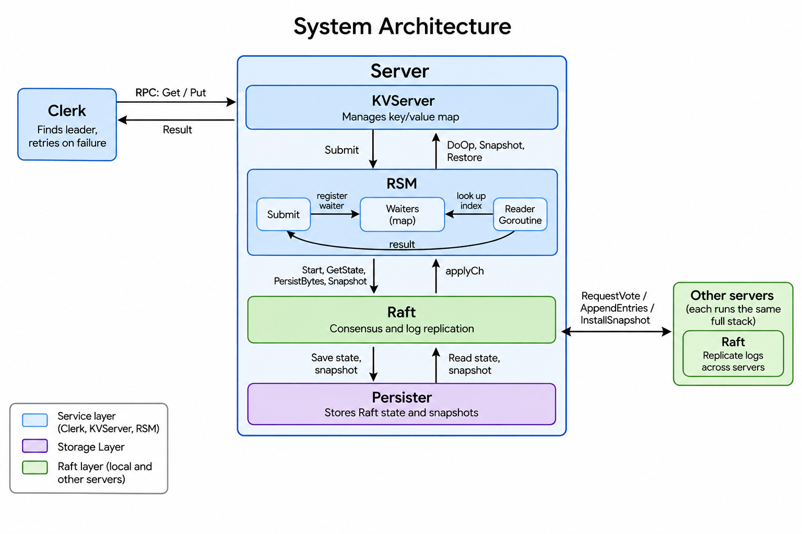

# Raft KV Store

A fault-tolerant, linearizable key/value store in Go, built on a Raft
consensus library. The service stays available as long as a majority of servers can communicate
and tolerates crashes, restarts, network partitions and message loss without
losing acknowledged writes.

This is a self-study project based on MIT 6.5840 (Distributed Systems). The
course's assignments come with skeleton code and automated tests, and this
repository contains my implementation of the Raft library (course Lab 3) and
the replicated key/value service (Lab 4).

## Credits and scope

The following come from MIT 6.5840 (Spring 2026): the starter code, the
simulated network (`labrpc`), the test harness (`tester1`, `kvtest1`,
`models1`) and the test suites. The Raft implementation, the replicated state
machine layer, the key/value server and the client in this repository are my
own work, written against that skeleton and test suite.

Not implemented: the MapReduce, single-server key/value, and sharding
assignments. Their directories (`mr`, `mrapps`, `kvsrv1`, `shardkv1`) contain
skeleton code only, apart from `kvsrv1/rpc`, which holds the request and
error types the key/value service shares.

## Architecture

`Submit` blocks until the operation is committed and applied, then returns
`(err, reply)` to the KVServer. On startup, RSM reads the saved snapshot from
the Persister and calls `Restore` before Raft starts.

- **Raft** (`src/raft1/raft.go`): leader election with randomized timeouts,
  log replication with conflict-term backtracking, persistence, and
  snapshot-based log compaction with an InstallSnapshot RPC.
- **RSM** (`src/kvraft1/rsm/rsm.go`): the layer between a service and Raft.
  `Submit` proposes an operation and waits for its result, a reader goroutine
  applies committed operations in order and wakes the request waiting on each
  one. It knows nothing about keys, so any service that implements `DoOp`,
  `Snapshot` and `Restore` can be replicated with it.
- **Key/value service** (`src/kvraft1/server.go`): versioned `Get` and `Put`.
  Every operation, including `Get`, goes through the log, so reads are
  linearizable.
- **Clerk** (`src/kvraft1/client.go`): retries across servers, remembers the
  last known leader, and returns `ErrMaybe` when a retried `Put` may already
  have been applied.

## Design decisions

- **Commit rule:** a leader only commits entries from its own term by
  counting replicas, earlier entries commit indirectly. This avoids the
  scenario in Figure 8 of the Raft paper, where a majority-replicated entry
  from an old term can still be overwritten.
- **Fast log repair:** a follower that rejects an append reports the
  conflicting term and the first index of that term, so the leader backs up
  one term at a time instead of one entry at a time.
- **Lost leadership:** each request carries a unique id. If a different
  operation commits at the request's log index, or the term changes while it
  waits, the request fails with `ErrWrongLeader` and the client retries.
- **Snapshots:** Raft indexes its log relative to the snapshot boundary. The
  state machine produces and restores the snapshot, and Raft stores and ships
  the bytes without reading them. A follower that is too far behind receives
  the leader's snapshot instead of individual entries.
- **Locking:** no lock is held across an RPC or a send on `applyCh`, which
  rules out the classic deadlock where two peers wait on each other's reply.

## Repository layout

    src/
      raft1/        Raft implementation
      kvraft1/      key/value server and client
        rsm/        replicated state machine layer
      raftapi/      interface between Raft and the layer above it
      labrpc/       simulated network (MIT)
      labgob/       encoding for RPC and persistence (MIT)
      tester1/      test harness (MIT)
      kvtest1/      key/value test helpers (MIT)
      models1/      test support (MIT)
      main/         test daemons (MIT)
      mr/ mrapps/ kvsrv1/ shardkv1/   not implemented, skeleton only

## Running the tests

    cd src
    make raft1                        # 3A-3D: elections, log replication,
                                      #   persistence, snapshots
    make RUN="-run 4A" rsm1           # 4A: replicated state machine layer
    make RUN="-run 4B" kvraft1        # 4B: key/value service
    make RUN="-run 4C" kvraft1        # 4C: key/value service with snapshots

## Results

All Raft (3A to 3D) and key/value service (4A to 4C) tests pass under the Go
race detector.

## Takeaways

Raft’s safety does not depend on timing, so the main design question was where each check should run. The version check runs in DoOp, when an entry is applied, so every replica reaches the same result. Each request carries a unique operation id, because a log index can later be reused by a different operation after a leader change. Handlers also re-check the term and role after any blocking call, since leadership may have changed while they waited.
